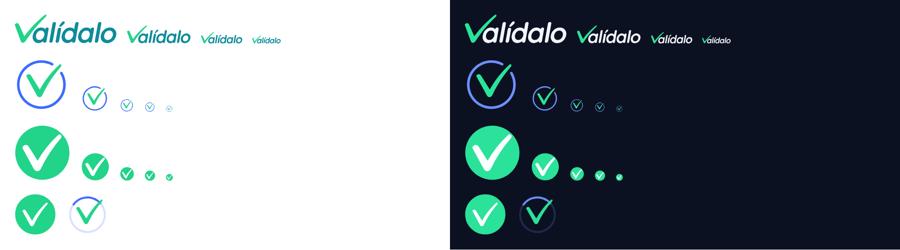

# Marca de Valídalo: la «V» con el check y el aro

| Estado | Fecha | Responsable |
|---|---|---|
| Vigente | 2026-11-18 | Producto (usuario) · Diseño |

**Propósito.** Dejar por escrito cómo se construye la marca, cuándo se usa cada pieza, qué no se debe hacer con ella y cómo se regeneran los recursos. Las decisiones están en el [registro](decisiones/registro.md) (MA-1 a MA-8 y NV-1 a NV-4). La única fuente de la geometría y de los colores es `packages/ui/src/marca/geometria.ts` (con `check.ts` y el `palabra.ts` generado) y `packages/ui/src/tokens.ts`; todo lo demás (componentes, favicon, íconos de la app, GIF, correos, PDF) sale de ahí o se comprueba contra ahí.



## 1. La idea

El producto se llama **Valídalo**, y el logotipo se lee así: un **check verde que hace de «V»** (el mismo trazo caligráfico del favicon, con el brazo derecho más largo) seguido de **«alídalo»** en minúsculas, en una tipografía redondeada y gruesa, inclinada hacia la derecha y de un solo color (verde azulado en claro, blanco en oscuro). La «V» no lleva círculo ni aro: es del alto de la letra, se apoya en la línea base y va pegada a la «a», con la cola de su brazo largo sobre ella. El check es un trazo caligráfico: se lee como «validado». Un **aro** lo acompaña en el ícono, donde hace falta un símbolo compacto (la app instalada, las animaciones): el check rompe el aro por arriba a la derecha, como algo que se confirma y sale. El favicon y el éxito conservan el **círculo verde** con el check blanco, porque ahí el círculo es intencional.

## 2. Las piezas

| Pieza | Qué es | Dónde va |
|---|---|---|
| **Logotipo** | La «V» (el check verde, sin círculo ni aro) y, pegada a ella, **alídalo** (todo en minúsculas, inclinada 10°; todas las letras de un solo color: verde azulado en claro y blanco en oscuro). Se lee «Valídalo». | Barras de las dos apps, ingreso, consola de Plataforma, verificador público, correos, PDF, documentación |
| **Ícono** | El aro abierto con el check un poco más grande, cuya punta sale por el hueco | App instalada (PWA), `apple-touch-icon`, avatar de la marca, notificaciones del tercero, pie del portal |
| **Favicon** | Círculo verde lleno con el check blanco (más grande y con contorno propio: a 16 px se sigue leyendo) | Pestaña del navegador (`favicon.svg` con modo claro/oscuro y PNG de 16, 32 y 48) |
| **Éxito** | El aro verde se dibuja, el círculo se llena y el check blanco se revela; «pop» final | Aprobación de un expediente, ficha completa, revisión aprobada del tercero, certificado vigente, GIF del correo de aprobación |
| **Carga** | Aro tenue, arco que gira y el check que se revela y se oculta | Carga previa al JavaScript (`index.html`), «Conectando con tu sistema…», GIF de carga |

## 3. Construcción

Todo está en un lienzo de coordenadas fijas; los números son los de `geometria.ts` y no se «aproximan» a mano.

- **Check**: `M24 38 C26 34 30 34 32 37 L47 61 C56 45 66 32 80 19 C82 17 85 19 83 22 C70 37 60 52 51 71 C49 75 44 75 42 71 Z`, relleno (`packages/ui/src/marca/check.ts`). Su caja exacta (la de su dibujo, no la de sus puntos de control) es `CAJA_CHECK`: x de 24 a 83,66 e y de 18,2 a 74.
- **Logotipo**: la **«V»** es el check escalado para medir **la letra** (100 unidades), con su punta de abajo en la **línea base** e **inclinado 10°** como la palabra; `check.ts` (`disponerLaV`) calcula ese trazado y `marca/contornos.mjs` lo escribe en `palabra.ts` (`PALABRA.v`: trazado y caja, con su borde izquierdo en x = 0). Sigue la palabra **«alídalo»** en minúsculas: todas las letras **de un solo color** (verde azulado en claro, blanco en oscuro), con **Quicksand Bold** (SIL OFL) convertida a **contornos** (`PALABRA.letras`, un solo trazado), seguimiento **−0,04 em**, espaciado parejo par por par e **inclinación de 10°** a la derecha. La palabra empieza **encima de la cola de la «V»** (margen negativo, `PALABRA.inicio`): el contorno de la «a» queda a **5 unidades** del check, medido como distancia real entre contornos (no solo en horizontal), así que la «V» se mete sobre la «a» sin tocarla. El `viewBox` es el de `CAJA_LOGOTIPO` y **incluye todo el dibujo** (la «V» inclinada con la cola de su brazo largo, el acento de la «í» y el sobrepaso de las curvas bajo la línea base) más `MARGEN_LOGOTIPO` (2 unidades) por cada lado; el `svg` de `Logo` además no recorta (`overflow: visible`) ni fija un alto que lo mutile. Las transformaciones son `TRANSFORMACION_V` y `TRANSFORMACION_PALABRA`. No hay texto ni fuentes: el logotipo es geometría.
- **Ícono**: caja `-3 -6 110 110`; aro abierto `M71.1 10.3 A45 45 0 1 0 89 27.5` (trazo 5, extremos redondeados); el check escalado ×1,15 desde su vértice (`translate(47 70) scale(1.15) translate(-47 -70)`).
- **Favicon**: círculo de radio 48 y el check blanco centrado, ×1,12, con contorno de 2,4 (único lugar donde se engrosa el check).
- **Aro completo** (éxito y carga): círculo de radio 45, trazo 5.
- **Revelado del check**: un relleno no se «dibuja» con `stroke-dashoffset`, así que el check se revela con una **máscara**: una guía `M28 37 L46 68 L82 20` con trazo ancho (18) y blanco avanza y descubre el check a su paso.

### Colores

El aro y el verde del check salen de `tokens.ts`; el color de las letras es propio de `geometria.ts` en claro (`#0E8C9A`, 4,0:1 sobre blanco, que cumple el 3:1 de texto grande y de logotipos al ser un dibujo grueso de 14 px o más) y es el texto de marca del token en oscuro (`marcaTexto`, 17,5:1 sobre el fondo oscuro). Nada cambia con la paleta de una empresa: el logo de Valídalo nunca toma el color de la empresa que se muestra en pantalla.

| Parte | Claro | Oscuro | Token |
|---|---|---|---|
| Aro | `#3D6BFF` | `#6E8FFF` | `marcaAzul` |
| Check (la «V» del logotipo, el círculo del favicon y el ícono), verde | `#22D38A` | `#2BE29A` | `marcaVerde` |
| Letras «alídalo» (palabra, un solo color) | `#0E8C9A` | `#F2F5FB` | — en claro (propio de la palabra); `marcaTexto` en oscuro |
| Check sobre el círculo verde (favicon y éxito) | `#FFFFFF` | `#FFFFFF` | — |
| Fondo de los íconos de la app y de los GIF oscuros | — | `#0B1120` | `superficieNivel1` oscuro |

### Animaciones

| | Éxito | Carga |
|---|---|---|
| Orden | Aro verde (0,45 s) → relleno (0,3 s) → check blanco con leve rebote (0,4 s) → «pop» 1 → 1,1 → 1 (0,3 s) | Arco del color del aro girando (1 s, lineal, sin fin; 80 de 210) + check revelándose y ocultándose (1,4 s) |
| Duración | 1,45 s, una vez | Sin fin |
| Menos movimiento (`prefers-reduced-motion`) | Aparece ya terminado y avisa su fin enseguida | Queda estática con un pulso suave de opacidad |
| Componente | `AnimacionExito` (con `onFin`) y `AnimacionExitoUnaVez` (se anima solo la primera vez de la sesión) | `Cargando` |

## 4. Cómo usarla

### Áreas de respeto y tamaños mínimos

- **Área de respeto**: alrededor del logotipo, **media letra** (0,5 × el tamaño de la letra) por cada lado; del ícono, **un octavo de su lado**. Nada entra ahí: ni texto, ni bordes, ni otro logo.
- **Tamaño mínimo del logotipo**: letra de **14 px** en pantalla (el conjunto mide ≈ 51 × 15 px) y **8 mm de alto de la «V»** en impreso.
- **Tamaño mínimo del ícono**: **24 px**. Por debajo, el favicon (el círculo verde), que está hecho para 16 px.
- En las barras de las apps el logotipo usa letra de 20 px.

### Usos correctos

- En su color sobre fondo claro (`Logo` claro) o con los colores de oscuro sobre fondo oscuro (`Logo` oscuro): en la web, el componente cambia solo con el tema.
- El logotipo en barras, ingreso, correos, PDF y documentos; el ícono solo donde no cabe el logotipo.
- El éxito en momentos que la persona provocó y que cierran algo (aprobar, completar, certificado vigente); la carga para esperas largas sin forma que mostrar.
- Donde se sabe qué va a llegar, la carga sigue siendo un **esqueleto** (UI-1): la carga de marca no lo reemplaza.

### Usos incorrectos

- Poner un aro al logotipo, o quitarle el aro al ícono.
- Cambiar los colores, usar la «V» en otro verde o la palabra en otros tonos; usar el color de la empresa en el logo de Valídalo.
- Deformar, rotar o cambiar la inclinación de la «V» o de la palabra (las dos van inclinadas 10° y nada más), agregar sombras, degradados o contornos (el único contorno es el del favicon).
- Separar la «V» de la palabra, ponerle un círculo o un aro, escribir «Valídalo» con mayúsculas o con otra tipografía (el logotipo es «V» + «alídalo» en minúsculas), o cambiar su inclinación o su espaciado.
- Poner el logo claro sobre fondo oscuro (o al revés) o sobre una foto o un color que le quite contraste.
- Usar el logo de Valídalo como logo de la empresa: el de la empresa (si lo configuró) va primero; el de Valídalo es el respaldo.
- Animar el logo en cada confirmación: la animación de éxito es para momentos que cierran algo; los avisos comunes llevan su ícono de siempre.

## 5. Dónde está cada cosa

| Qué | Dónde |
|---|---|
| Geometría, colores y tiempos | `packages/ui/src/marca/geometria.ts`, `packages/ui/src/tokens.ts` |
| Contornos de la palabra «alídalo» y de la «V» | `packages/ui/src/marca/palabra.ts` (generado por `marca/contornos.mjs`; el check y su caja, en `check.ts`) |
| Componentes | `Logo` (`logotipo`, `icono`, `favicon`), `AnimacionExito`, `AnimacionExitoUnaVez`, `Cargando` en `@validalo/ui` |
| Recursos generados | `marca/svg/`, `marca/png/` (incluye `hoja-de-marca.png`), `marca/gif/` |
| Favicon, íconos y manifest de las apps | `apps/web/public/` y `apps/public/public/`; enlazados en cada `index.html` |
| Carga previa al JavaScript | Entre las marcas `marca:splash:inicio` y `marca:splash:fin` de cada `index.html` |
| Marco y recursos de los correos | `src/Validalo.Aplicacion/Comun/MarcoDeCorreo.cs` y `Comun/RecursosDeMarca/` |
| Logotipo en los PDF | `src/Validalo.Infraestructura/Ficha/LogosDePdf.cs` (`LogotipoDeValidalo`, un SVG de trazados que repite los de la web) |

### Correos

Todos los correos salen dentro de un marco (`MarcoDeCorreo`): el logotipo arriba y el contenido en una tarjeta blanca, con colores explícitos para que un cliente en modo oscuro no los invierta. Las imágenes **viajan dentro del mensaje** (`cid:`), no se piden por URL: muchos clientes bloquean las imágenes remotas y no queremos que un correo de validación haga peticiones a nadie. El correo de **aprobación** abre además con el **GIF de éxito** (anima una vez y se queda en el círculo verde con el check, que sigue siendo el símbolo del éxito; un cliente que no anima GIF muestra el último cuadro). La vista previa de las plantillas incrusta el GIF como `data:` para mostrarlo.

### PDF

El logo de la **empresa** (PNG o SVG que configuró) sigue siendo el primero en el encabezado de la declaración PEP. Si no tiene, el respaldo es el **logotipo de Valídalo dibujado como vectores** en el lienzo propio del PDF (la «V» verde y «alídalo» en contornos, los mismos trazados del logotipo: no hay fuentes que incrustar). El PDF del certificado lleva el logotipo bajo su título: lo valida la plataforma.

## 6. Cómo se regenera

```bash
pnpm --filter @validalo/e2e navegadores      # la primera vez: Chromium de Playwright
pnpm --filter @validalo/marca generar        # SVG, PNG, GIF, carga previa al JavaScript y los recursos de los correos
pnpm --filter @validalo/marca generar -- --solo svg,png   # solo una parte (svg, png, gif, splash)
pnpm --filter @validalo/marca contornos      # solo si cambia la fuente, el peso, el seguimiento o la inclinación de la palabra
```

Requiere **Node 23.6 o superior** (el generador lee `gif.ts` y `png.ts` sin compilar). El generador abre un arnés (`marca/harness`) con los **componentes reales** de `@validalo/ui`, congela cada animación en cada instante (Web Animations) y captura los cuadros con Playwright: lo que se ve en la app es lo que sale en el GIF. Los GIF van a 2× (96 px en pantalla = 192 px) con el fondo de cada modo; un codificador propio (`marca/gif.ts`: paleta por mediana, LZW, solo el rectángulo que cambia) los deja en ≈ 80 KB. El GIF de carga usa un ciclo de 2 s (dos vueltas del arco y un ciclo del check algo más lento que el de 1,4 s de la app) para repetirse sin saltos.

El resultado **se versiona**. Para que no se separe de la geometría hay pruebas que solo leen archivos (`marca/sincronia.test.ts`, en `pnpm test`): las copias de las apps y de los correos son idénticas a lo generado, los SVG llevan los números de `geometria.ts`, la carga de `index.html` y el PDF repiten la misma geometría y los mismos colores.

**Para cambiar la marca**: se cambia `geometria.ts` o `tokens.ts` (y, si cambian la palabra, la «V» o sus colores, se corre `contornos` y se repite el SVG de `LogosDePdf.cs`: sale de `marca/svg/logotipo-claro.svg`), se corre el generador y se versiona lo que salga. Un cambio que no llegue al PDF o a `index.html` hace fallar `sincronia.test.ts`, que además **mide el PNG del logotipo píxel a píxel**: la «V» del alto de la letra y con la punta en la línea base (a un par de píxeles), metida sobre la «a» sin tocarla y con el margen de seguridad libre por los cuatro lados, de modo que ni la cola del check ni el acento de la «í» quedan contra el borde.

## 7. Tipografía del logotipo

La palabra del logotipo **no es texto**: es la fuente **Quicksand Bold** (peso 700, licencia SIL Open Font License 1.1, que permite incrustarla y derivar contornos) convertida a trazados por `marca/contornos.mjs` (con `opentype.js` y el paquete `@fontsource/quicksand`, ambos solo dependencias de desarrollo de `marca/`) y escrita en `palabra.ts`. De ahí que `Logo`, los SVG (`marca/svg/logotipo-*.svg`), los PNG, los GIF, los correos y el PDF dibujen lo mismo sin depender de ninguna fuente instalada o cargada. El generador aplica un seguimiento de −0,04 em y mide el espacio real entre cada par de letras (a-l, l-í, í-d, d-a, a-l, l-o) para dejarlo parejo, y después inclina los contornos 10° a la derecha desde la línea base. La «V» (el check) se inclina igual y la palabra se acerca a ella hasta que el contorno de la «a» queda a 5 unidades del check.
